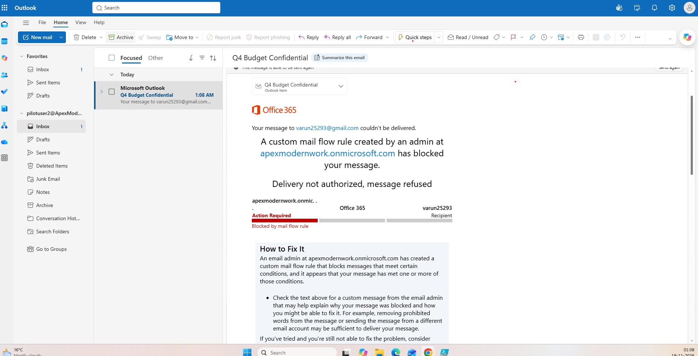

# Enterprise Microsoft Purview Sensitivity Labels & DLP Governance Lab

## Executive Summary
This repository documents an end-to-end **Information Protection & Data Loss Prevention (DLP)** architecture implemented in the `ApexModernWork.onmicrosoft.com` Microsoft 365 tenant. The lab enforces document-level AES encryption with dynamic watermarking alongside perimeter email DLP blocking to prevent unauthorized external transmission of confidential financial data.

---

## Architecture & Security Controls Implemented

| Layer | Security Control | Policy / Rule Name | Enforcement Behavior |
| :--- | :--- | :--- | :--- |
| **Classification & Encryption** | Microsoft Purview Sensitivity Label | `Confidential - Finance` | Applies AES encryption, restricts external permissions, and stamps dynamic diagonal watermarks & headers |
| **Multi-Workload DLP** | Microsoft Purview DLP Policy | `DLP-Block-External-Financial-Sharing` | Monitors Exchange, SharePoint, OneDrive & Teams for sensitive financial info types (`Credit Card Number`, `ABA Routing Number`) |
| **Perimeter Mail Flow DLP** | Exchange Online Transport Rule (ETR) | `DLP-Block-External-Confidential-Finance-ETR` | Real-time outbound enforcement (`Priority 0`) rejecting unauthorized external financial emails with `5.7.1` NDR bounce |

---

## Lab Evidence & Verification

### 1. Purview Sensitivity Label Configuration & Encrypted Document Enforcement
* Created and published the `Confidential - Finance` sensitivity label with encryption and content marking enabled.
* Verified real-time label application, diagonal watermarking, and access control on `Q4-Corporate-Budget-2026.docx` in SharePoint / Word Online.

### 2. Purview DLP Policy & Outbound Email Blocking Enforcement
* Configured `DLP-Block-External-Financial-Sharing` across M365 workloads and layered `DLP-Block-External-Confidential-Finance-ETR` in Exchange Online for zero-latency outbound enforcement.
* Tested outbound transmission from `pilotuser2@ApexModernWork.onmicrosoft.com` to an external recipient (`varun25293@gmail.com`) with subject `Q4 Budget Confidential` — verified immediate `5.7.1` delivery refusal.

---

## Troubleshooting & Production Engineering Takeaways
* **Purview Multi-Workload Sync Latency:** Newly created or modified Purview DLP policies take up to **2 hours** (and up to 24 hours for group-scoped policies) to propagate across Exchange, SharePoint, OneDrive, and Teams. Layering an Exchange Online Transport Rule (`Priority 0`) provides immediate perimeter protection during policy propagation.
* **OWA vs. SMTP Inbound Scope:** In Exchange Transport Rules, `FromScope: InOrganization` applies to inbound connector submissions rather than direct Outlook Web (OWA) client submissions; targeting explicit user/group conditions ensures deterministic evaluation for internal webmail traffic.